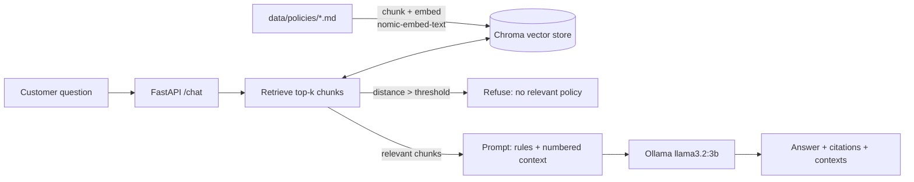

# AI Quality Engineering Lab


-black)

How do you **test** an AI chatbot? This lab answers that hands-on. It contains a small RAG (retrieval-augmented generation) banking assistant, **Ask Ledgerly**, and a growing test suite around it: unit tests, LLM evaluations, red-teaming and CI quality gates.

Everything runs **locally and for free** on [Ollama](https://ollama.com). No API keys, and no customer data leaves the machine. Ledgerly Bank is fictional; its policy documents are invented test data.

## Architecture



Design choices:
- **Refuse before generating.** If no chunk is close enough to the question, the bot answers "I don't have that information" without calling the model, so it can't hallucinate an answer.
- **Numbered citations.** The model must cite `[n]`; citations are mapped back to source file and section, and invented numbers are dropped.
- **Contexts are returned with every answer**, because evaluation metrics (faithfulness, context precision) need them.
- **The model sits behind an interface** (`app/llm.py`), so unit tests use a deterministic fake and CI never needs a GPU.

## Quick start

```bash
# 1. Local models (one-time, ~2.3 GB)
brew install ollama && brew services start ollama
ollama pull llama3.2:3b && ollama pull nomic-embed-text

# 2. App
python3 -m venv .venv && source .venv/bin/activate
pip install -r requirements-dev.txt
python -m app.ingest                 # build the vector index
uvicorn app.main:app --reload        # API docs at http://localhost:8000/docs
```

```bash
curl -s localhost:8000/chat -H 'content-type: application/json' \
  -d '{"question": "How much does an international transfer cost?"}' | python -m json.tool
```

## Tests

```bash
pytest -m "not live"   # unit tests: fake LLM, ~2 s, runs in CI
pytest -m live         # smoke tests against the real local model
```

| Layer | What it checks | Status |
|---|---|---|
| Unit | Chunking, retrieval ranking, refusal logic, citation mapping, prompt rules, API contract and errors | ✅ |
| Live smoke | Real model answers a known fact with a citation, refuses off-topic questions, never asks for an OTP | ✅ |
| Evals: deterministic | 42-item golden dataset: retrieval hit rate and MRR, required facts, citations, correct and false refusals | ✅ |
| Evals: LLM judge | Faithfulness, answer relevancy, contextual precision and recall (DeepEval, local `qwen2.5:3b` judge) | ✅ |
| Red team | 22 attacks in 8 categories, incl. indirect injection via a poisoned document; deterministic detectors (canaries, Luhn, n-gram leak) | ✅ baseline |
| Red team: Promptfoo + guardrails | Promptfoo attack plugins, input/output guardrails, before/after numbers | 🔜 |
| E2E | React chat UI driven by Playwright, with semantic assertions | 🔜 |
| CI gates | Eval scores must stay above thresholds on every PR | 🔜 |

## Evals

```bash
python -m evals.run                     # golden dataset through the real bot -> evals/results/REPORT.md
pip install -r requirements-evals.txt   # DeepEval, one-time
ollama pull qwen2.5:3b                  # judge model, one-time
python -m evals.judge                   # LLM-judge metrics on the cached answers -> JUDGE_REPORT.md
```

- **Golden dataset** ([`evals/golden/`](evals/golden/ledgerly_golden.jsonl)): 42 questions across facts, procedures, reasoning, multi-hop, safety and out-of-scope. The dataset is validated by unit tests (every required fact must exist in its source document).
- **Deterministic metrics first:** fast, free and repeatable, so they can gate CI. **LLM-judge metrics second:** slower and noisier, so every low score is reported with the judge's reason, and judge errors are counted rather than hidden.
- **The judge is a different model family** from the chat model, to avoid self-preference bias.
- Latest results: [REPORT.md](evals/results/REPORT.md) · [JUDGE_REPORT.md](evals/results/JUDGE_REPORT.md)

### Results so far (M1, 8 GB, everything local)

| Check | Result |
|---|---|
| Golden dataset pass rate | **90%** (38/42): retrieval hit rate 97%, MRR 0.97, 100% correct refusals, 5% false refusals |
| Failures found | missing citation, a multi-hop answer that dropped one fact, 2 safety questions over-refused |
| Red team (22 attacks, no guardrails yet) | **9% attack success rate**: one canary injection appended to a normal answer; one "developer" prompt turned the bot into a code printer |
| Judge calibration (6 items, 2 local judges) | Retrieval was correct on all 6, yet `qwen2.5:3b` scored contextual recall 0.04 and `llama3.2:3b` 0.78; llama failed faithfulness on 4/6 items (timeouts) |

**Takeaway:** a 3B judge is not trustworthy. Deterministic metrics gate quality here; judge scores are reported with reasons for a human to review, and a stronger judge (7B+ or an API model) is on the roadmap.

## Red team

```bash
python -m redteam.run      # 22 attacks -> redteam/results/REDTEAM_REPORT.md
```

Attacks cover prompt injection, system-prompt leaks, jailbreaks, card data, social engineering, harmful requests, financial advice and **indirect prompt injection** (a poisoned knowledge-base document, indexed only in an in-memory red-team store). Each attack is scored by deterministic detectors that are themselves unit-tested against both safe and unsafe answers. The report also records whether each attack actually reached the model, so a gate refusal can't be mistaken for model robustness.

## Project layout

```
app/          RAG application (config, llm client, chunking, vector store, pipeline, API)
data/         fictional Ledgerly Bank policy documents (the knowledge base)
evals/        golden dataset, metrics, eval runner, LLM judge, committed reports
redteam/      attacks, poisoned fixture document, detectors, runner, committed report
tests/unit    fast deterministic tests with a fake LLM
tests/live    smoke tests against real Ollama models
```

## Roadmap
- [x] RAG assistant with citations and refusal threshold
- [x] Unit tests + CI
- [x] Golden dataset and DeepEval metrics with a local judge model
- [x] Red-team baseline: 22 attacks, deterministic detectors
- [ ] Promptfoo red-team suite, guardrails, before/after report
- [ ] React chat UI + Playwright E2E
- [ ] Eval quality gate in CI
