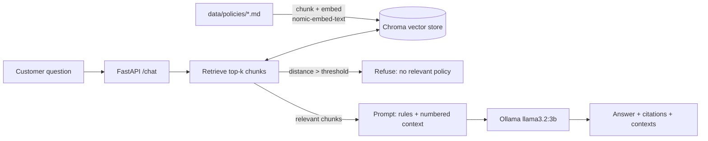

# AI Quality Engineering Lab


-black)

How do you **test** an AI chatbot? This lab answers that hands-on. It contains a small RAG (retrieval-augmented generation) banking assistant, **Ask Ledgerly**, and a growing test suite around it: unit tests, LLM evaluations, red-teaming and CI quality gates.

Everything runs **locally and for free** on [Ollama](https://ollama.com). No API keys, and no customer data leaves the machine. Ledgerly Bank is fictional; its policy documents are invented test data.

## Architecture



Design choices:
- **Refuse before generating.** If no chunk is close enough to the question, the bot answers "I don't have that information" without calling the model, so it can't hallucinate an answer.
- **Numbered citations.** The model must cite `[n]`; citations are mapped back to source file and section, and invented numbers are dropped.
- **Contexts are returned with every answer**, because evaluation metrics (faithfulness, context precision) need them.
- **The model sits behind an interface** (`app/llm.py`), so unit tests use a deterministic fake and CI never needs a GPU.

## Quick start

```bash
# 1. Local models (one-time, ~2.3 GB)
brew install ollama && brew services start ollama
ollama pull llama3.2:3b && ollama pull nomic-embed-text

# 2. App
python3 -m venv .venv && source .venv/bin/activate
pip install -r requirements-dev.txt
python -m app.ingest                 # build the vector index
uvicorn app.main:app --reload        # API docs at http://localhost:8000/docs
```

```bash
curl -s localhost:8000/chat -H 'content-type: application/json' \
  -d '{"question": "How much does an international transfer cost?"}' | python -m json.tool
```

## Tests

```bash
pytest -m "not live"   # unit tests: fake LLM, ~2 s, runs in CI
pytest -m live         # smoke tests against the real local model
```

| Layer | What it checks | Status |
|---|---|---|
| Unit | Chunking, retrieval ranking, refusal logic, citation mapping, prompt rules, API contract and errors | ✅ |
| Live smoke | Real model answers a known fact with a citation, refuses off-topic questions, never asks for an OTP | ✅ |
| LLM evals | Golden dataset; faithfulness, answer relevancy, context precision/recall, hallucination (DeepEval) | 🔜 |
| Red team | Prompt injection, PII leakage, jailbreaks, off-topic and bias probes (Promptfoo) | 🔜 |
| E2E | React chat UI driven by Playwright, with semantic assertions | 🔜 |
| CI gates | Eval scores must stay above thresholds on every PR | 🔜 |

## Project layout

```
app/          RAG application (config, llm client, chunking, vector store, pipeline, API)
data/         fictional Ledgerly Bank policy documents (the knowledge base)
tests/unit    fast deterministic tests with a fake LLM
tests/live    smoke tests against real Ollama models
```

## Roadmap
- [x] RAG assistant with citations and refusal threshold
- [x] Unit tests + CI
- [ ] Golden dataset and DeepEval metrics with a local judge model
- [ ] Promptfoo red-team suite, guardrails, before/after report
- [ ] React chat UI + Playwright E2E
- [ ] Eval quality gate in CI
